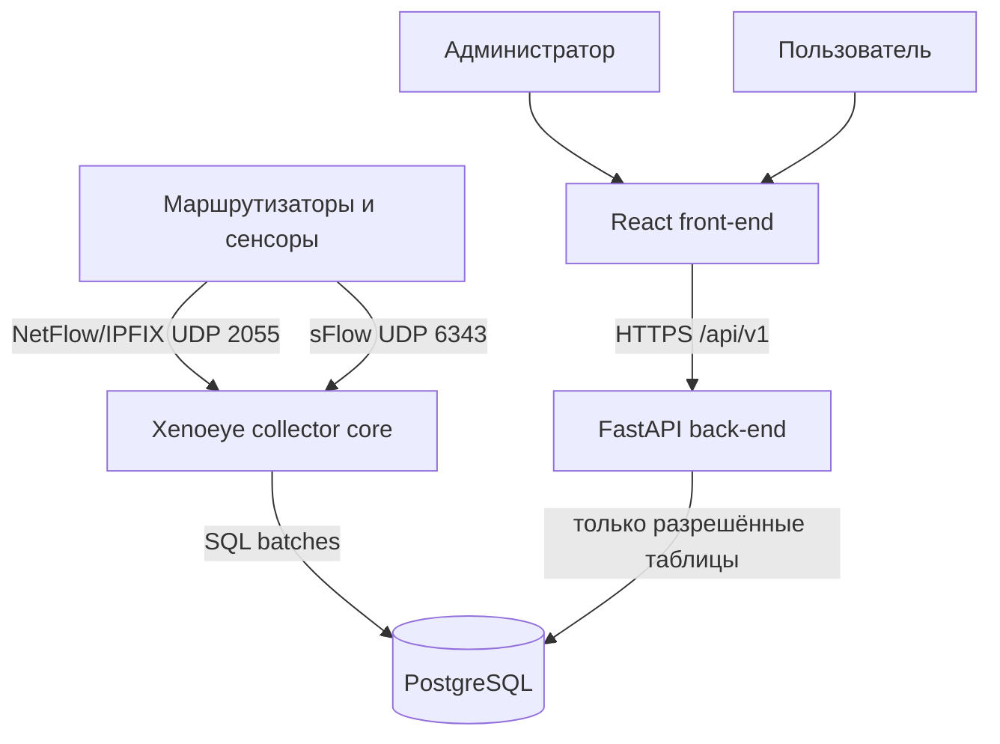

# Архитектура Xenoeye Portal

## Компоненты

### Collector core

Существующий C-код. Работает независимо от портала и продолжает собирать данные, даже если UI или API остановлены. При недоступной БД SQL-файлы остаются в `/var/lib/xenoeye/exp`; неуспешные пакеты перемещаются в `expfailed`.

### Back-end API

Каталог `backend/`. FastAPI/SQLAlchemy/Psycopg выполняют четыре функции:

- аутентификация по email и паролю, JWT-сессия;
- администрирование пользователей;
- обнаружение динамических таблиц Xenoeye через `information_schema`;
- агрегированные запросы временных рядов для UI.

### Front-end

Каталог `frontend/`. React/TypeScript/Vite. Интерфейс включает:

- защищённую страницу входа;
- обзорные KPI и график трафика;
- исследование доступных таблиц и метрик;
- профиль и смену пароля;
- административный раздел создания/отключения пользователей.

## Модель доступа

Каждая запись `xe_portal_users` содержит `allowed_tables` — JSON-массив точных имён таблиц. Значение `*` разрешено только как административная настройка и даёт доступ ко всем текущим и будущим таблицам.

API сначала получает реальный список таблиц PostgreSQL, затем пересекает его со списком пользователя. Имя таблицы и столбца никогда не принимается на доверии: оно должно существовать в обнаруженной схеме. После проверки идентификатор экранируется перед включением в SQL. Это защищает как от обхода RBAC, так и от SQL injection через параметры аналитических запросов.

Роли:

- `Администратор`: все таблицы, управление пользователями и назначение доступа.
- `Аналитик`: только явно назначенные таблицы, собственный профиль и предпочтения.

## Потоки данных

1. Сенсор отправляет flow-пакет.
2. C-ядро декодирует его, применяет фильтры `mo.conf` и агрегирует значения.
3. По окончании окна ядро создаёт транзакционный SQL-файл.
4. Экспортный скрипт импортирует файл в PostgreSQL.
5. UI запрашивает `/traffic/summary`, `/traffic/series` или `/traffic/top`.
6. API проверяет JWT и разрешённые таблицы, выполняет ограниченный агрегированный SQL и возвращает JSON.

## Каталоги

| Путь | Назначение |
|---|---|
| `backend/app` | FastAPI, модели, RBAC и запросы трафика |
| `frontend/src` | React-интерфейс личного кабинета |
| `deploy/systemd` | unit-файлы collector и API |
| `deploy/nginx` | reverse proxy и раздача SPA |
| `deploy/docker` | контейнерная конфигурация и стартовые объекты мониторинга |
| `scripts/install-*-debian.sh` | автоматическая установка Debian 12/13 |

